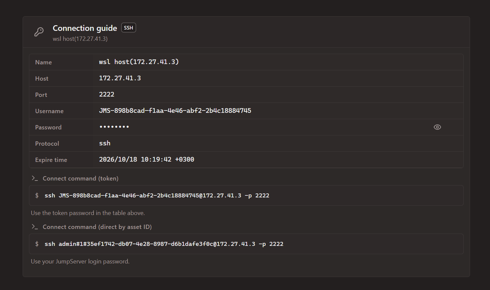

# Jumpserver PAM instructions

Instruction for installation Jampserver 5.1 in WSL. Suitable for common linux server with a few changes

## Prepare

Make dirs:

    sudo mkdir -p /opt/jumpserver/config/nginx/cert
    sudo chown -R $USER /opt/jumpserver

    sudo mkdir /opt/jumpserver-data
    sudo chown -R $USER /opt/jumpserver-data

    ls -l /opt

Gen certificate:

    openssl req -x509 -newkey rsa:4096 \
        -keyout /opt/jumpserver/config/nginx/cert/server.key \
        -out    /opt/jumpserver/config/nginx/cert/server.crt \
        -sha256 -days 3650 -nodes \
        -subj "/CN=Jumpserver PAM" \
        -addext "subjectAltName=DNS:*,IP:127.0.0.1"

    ls -l
    openssl x509 -text -in /opt/jumpserver/config/nginx/cert/server.crt

Change `SECRET_KEY`, `BOOTSTRAP_TOKEN`, `DB_PASSWORD`, `REDIS_PASSWORD` and copy config:

    nano config.txt
    cp config.txt /opt/jumpserver/config/config.txt

Get distrib and unpack

    wget https://github.com/jumpserver/installer/releases/download/v5.1.0/jumpserver-installer-v5.1.0.tar.gz

    tar -xvzf jumpserver-installer-v5.1.0.tar.gz -C ./

### Set ssh for testing

    ssh-keygen
    touch ~/.ssh/authorized_keys
    chmod 600 ~/.ssh/authorized_keys
    cat ~/.ssh/id_ed25519.pub >  ~/.ssh/authorized_keys

    sudo apt install openssh-server

## Install and verify

Install:

    cd jumpserver-installer-v5.1.0

    ./jmsctl.sh load_image
    docker image ls

    sudo ./jmsctl.sh install && sudo ./jmsctl.sh start
    # Save credentials

Verify:
    
    docker ps
    ./jmsctl.sh tail

## Access and testing

1) Open https://172.27.41.3/ui in browser.

2) Make group https://172.27.41.3/ui/#/console/users/groups

3) Make user https://172.27.41.3/ui/#/console/users/users Set password and ssh key

4) Make asset https://172.27.41.3/ui/#/console/assets/assets

5) Make permission https://172.27.41.3/ui/#/console/perms/asset-permissions

6) Get connection link https://172.27.41.3/ui/#/workbench/assets and test connection

